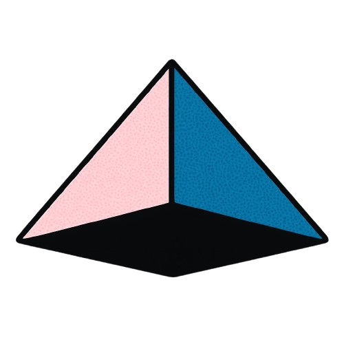

<p align="center">
  
</p>

<h1 align="center">Superagent Security Graph</h1>

<p align="center">
  <strong>Shared security memory for the agents you already use.</strong>
</p>

<p align="center">
  <a href="https://superagent.sh">Website</a> ·
  <a href="#run-locally">Quickstart</a> ·
  <a href="AGENTS.md#using-security-graph">Agent guide</a> ·
<a href="https://superagent.sh">
  <picture>
    <source media="(prefers-color-scheme: dark)" srcset="https://www.superagent.sh/api/badge/superagent-ai/security-graph/shield.svg?theme=dark&accent=teal&variant=streak">
    
  </picture>
</a>
</p>

---

Security Graph is a security context engine for pentesters, PR reviewers, and coding agents. It stores findings, assessment reports, evidence, and triage decisions, and makes them available through MCP so each agent can build on earlier security work.

## Why Security Graph?

An agent reviewing a change needs to know what has already been investigated: which vulnerabilities were reported, how they were reproduced, and why they were fixed, dismissed, or accepted as risk. Security Graph keeps that context available between agents and assessments.

- **Before an assessment:** Retrieve existing findings, evidence, and review decisions for the target and related assets.
- **During an assessment:** Record structured findings with code references, a PoC, and remediation evidence using Superagent's finding template.
- **After an assessment:** Finish the report and let authorized reviewers update finding dispositions. Later agents can retrieve the results.

The graph connects security records: assets, reports, findings, and vulnerability classifications. Those relationships let an agent follow a finding back to its assessment or retrieve findings for related assets.

Your agents perform the assessments; Security Graph preserves what they learn. Use your own agents and models, and run the Go service with PostgreSQL on your infrastructure.

## PR scans and pentests

Security Graph can provide shared memory around your existing security workflow. An agent can retrieve earlier context, investigate results from a review or scanner, and record findings for the next assessment.

**Integration status:** Direct agent access through MCP is available today. The vendor connections below are proposed integration patterns; this repository does not yet ship vendor connectors or verify these combinations end to end.

| Tool or method | Workflow | Connection pattern |
| --- | --- | --- |
| Your own MCP-capable agent | PR security review or repository pentest | Connect directly to Security Graph to retrieve context and submit structured assessment results. |
| [Greptile](https://www.greptile.com/docs/mcp/overview) | AI PR review | Have an agent read Greptile review comments through its MCP server, investigate security issues, and record findings in Security Graph. |
| [CodeRabbit](https://docs.coderabbit.ai/knowledge-base/mcp-context) | AI PR review | Evaluate Security Graph as a custom MCP knowledge source for review context. An agent can separately investigate results from [CodeRabbit's CLI](https://docs.coderabbit.ai/cli) or PR comments. |
| [Vercel deepsec](https://deepsec.sh/docs/getting-started) | Repository security scans | Have an agent or custom adapter read exported findings and supply the evidence required by Security Graph's submission contract. |
| [Semgrep](https://semgrep.dev/products/community-edition/) | Static analysis | Have an agent or custom adapter investigate selected JSON or SARIF results and prepare structured findings. |

## Run locally

You'll need Docker with Compose and a checkout of this repository.

### 1. Prepare the local database

Copy the example configuration:

```sh
cp .env.example .env
```

Set a long password in `.env`, using the same password for `POSTGRES_PASSWORD` and `DATABASE_URL` (URL-encoded in the URL if needed). Then build the service and prepare PostgreSQL:

```sh
docker compose build
docker compose run --rm migrate
```

The database starts empty and retains data across restarts. You only need to prepare it once; rebuild and rerun migrations when upgrading.

### 2. Connect your agent

Add this **stdio MCP server** to your agent's configuration, replacing both paths with your checkout location:

```json
{
  "mcpServers": {
    "security-graph": {
      "command": "docker",
      "args": [
        "compose", "--project-directory", "/absolute/path/to/security-graph",
        "--env-file", "/absolute/path/to/security-graph/.env",
        "run", "--rm", "--no-deps", "-T", "server", "stdio"
      ]
    }
  }
}
```

Your agent launches the Go process and communicates through its input/output streams. No MCP API key, login, or HTTP endpoint is needed. The process has assessment permissions in a local workspace; advanced access settings are in [AGENTS.md](AGENTS.md#using-security-graph).

Ask your agent to register `acme/payments`, read its context, and record an assessment. The usual tool sequence is:

```text
create_asset → get_context → create_report → submit_finding → finish_report
```

Every tool call requires an `intent` describing its purpose. The agent discovers the required inputs through MCP. Finding submissions currently require repository evidence, including code references, a PoC, and patch validation; see the [agent guide](AGENTS.md#using-security-graph).

The MCP process exits when your agent disconnects. To stop PostgreSQL while keeping its data, run `docker compose down`.

## Use it with your infrastructure

**Standalone / on-prem:** Run the same service against your own PostgreSQL database. For shared remote access, use authenticated HTTP behind HTTPS; see [HTTP credentials](AGENTS.md#http-credentials-and-client-configuration). Other databases can be supported through the [storage adapter interface](docs/storage-adapters.md).

**Native Superagent:** Run the service against the existing App database and configure App to forward MCP calls to it. Agents use their existing Superagent API keys; organization access comes from the key. This requires the App migration and service configuration described in the [native integration guide](docs/superagent-integration.md).

## More

- [Agent guide: credentials, findings, and report lifecycle](AGENTS.md#using-security-graph)
- [Development, integration tests, and releases](docs/development.md)
- [Product and implementation plan](docs/product-and-implementation-plan.md)
- [Finding/report compatibility](docs/source-compatibility.md)

### Vulnerability classifications

The engine includes a curated, versioned vulnerability catalog and sourced
mappings to CWE, OWASP, MITRE ATLAS and AIUC-1. Agents can discover the catalog,
assign existing types, and optionally run Julia-1 locally for model suggestions.
See [catalog, graph relationships and local classifier setup](docs/vulnerability-catalog.md).
